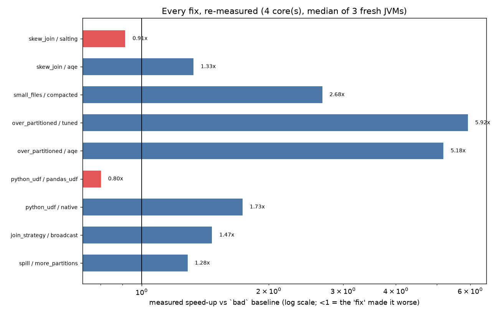

# spark-bottleneck-lab

**Don't guess why a Spark job is slow. Locate the bottleneck, classify it, explain it with evidence, fix it, and re-measure.**

Two things in one repo:

1. **A diagnoser** (`bottleneck_lab/diagnose.py`) that reads any Spark event log and answers, in this order: *where* the wall-clock goes (critical path), *what kind* of bottleneck it is (CPU / GC / shuffle-fetch / per-task overhead / other waiting), and *why* (rules for skew, tiny tasks, small files, spill, Python UDFs, shuffled-but-broadcastable joins). Each finding prints the numbers that triggered it.
2. **A lab** of six reproducible workloads, each with an injected pathology and one or more fixes. Every fix is re-measured (median of 3 fresh JVMs), its **result checksum is verified identical**, and the diagnoser is checked on whether it named the injected cause.

```bash
pip install -r requirements.txt            # Java 17 + Python 3.12 (see Gotchas)
python -m bottleneck_lab.cli path/to/spark-eventlog      # diagnose YOUR job (.log or .gz)
./run_all.sh 4 1                                         # reproduce the lab: 4 cores, scale 1
```

## Environment these numbers were measured on

Windows laptop, 8 physical cores (16 logical) with 4 used per run, 16 GB RAM (7 GB visible to WSL2), Ubuntu on WSL2, OpenJDK 17.0.20, Python 3.12, Spark 3.5.3 in **local mode** (one machine, no real network), scale 1 (6M-row fact table), synthetic data with fixed seeds.

## Results (4 cores, median of 3 fresh JVMs; second of two full runs)

Two complete runs on the same machine differed by up to 11% in absolute times (for example the spill fix measured 1.15x in the first run and 1.28x in the second). Read ratios as roughly +/-10%. Conclusions that held in **both** runs: every variant returned an identical result; over-partitioning, small files, native expressions and broadcast gave clear gains; AQE beat salting; salting and the pandas UDF were slower than their baselines.

| Scenario | Injected problem | Bad | Variant | After | Speed-up | Result identical |
|---|---|---:|---|---:|---:|:--:|
| over_partitioned | `shuffle.partitions=3000` | 7.02 s | 8 partitions | 1.19 s | **5.9x** | yes |
| | | | AQE coalescing | 1.35 s | **5.2x** | yes |
| small_files | 1,500 tiny parquet files | 3.06 s | compacted to 6 files | 1.14 s | **2.7x** | yes |
| python_udf | row-at-a-time UDF | 2.26 s | native expressions | 1.30 s | **1.7x** | yes |
| | | | pandas UDF | 2.82 s | **0.80x (worse)** | yes |
| join_strategy | small dim shuffled (SMJ) | 2.87 s | broadcast hash join | 1.96 s | **1.47x** | yes |
| skew_join | 50% of rows on one key | 6.46 s | AQE skew-join | 4.87 s | **1.33x** | yes |
| | | | hand-rolled salting | 7.07 s | **0.91x (worse)** | yes |
| spill | spill in a 2-partition sort | 6.28 s | 24 partitions | 4.89 s | 1.28x | yes |



Per-scenario reports are in `results/scenarios/*.md`, and the Spark event logs behind every number are in `results/eventlogs/`, so each claim can be re-derived.

### Does the diagnoser name the injected cause?

- **6 / 6** injected pathologies were named on the bad runs.
- **Nothing was flagged** on the cleanly fixed variants (compacted, tuned, AQE-coalesced, broadcast, native).
- Findings that remained after a fix were legitimate: spill after AQE/salting (the hot partition and shuffle buffers still spill under the deliberately tight memory), Python UDF after the pandas UDF (it still crosses the JVM/Python boundary).
- During development one false positive was found and fixed: a cold-JIT first task looked like skew. The rule now requires the **data** to be lopsided, not just the time (`test_skew_NOT_flagged_when_only_time_is_lopsided`).
- This is self-graded on workloads I wrote. It is a sanity check, not a benchmark.

## What the experiments showed

1. **Hand-rolled salting did not pay.** It added a sampling job and per-row work and ran about 9% slower than the unfixed join, while Spark's AQE skew-join gained 1.33x. I did not isolate exactly where salting's extra time goes; the likely cost is the added serial work, which I have not measured separately.
2. **A pandas UDF did not beat the plain UDF here** (2.82 s vs 2.26 s). Only native expressions helped (1.30 s). A plausible reason is that this UDF is trivial, so Arrow batching overhead is not repaid; I have not tested larger UDFs.
3. **Too many tiny tasks was the largest single win** (5.9x). AQE's automatic coalescing recovered nearly all of it with no code change.
4. **Fixing a diagnosed problem is not the same as fixing the clock.** The spill finding is real and remains after the fix, yet the gain was a modest 1.28x, against 5.9x for the partition-count fix. The per-run diagnosis shows which stage dominates the critical path; see `results/scenarios/spill.md`.
5. **Skew limits how much parallelism helps.** Going from 1 to 4 cores sped the skewed join up only 1.41x (9.10 s → 6.46 s); salting 1.56x (11.02 → 7.07 s), AQE 1.69x (8.22 → 4.87 s). With 4x the cores, none got close to 4x. This is consistent with skew being a limiter, but I did not run an experiment that isolates skew as the cause.

## Model validation: the projection model failed

An earlier version of this tool projected skewed-stage times onto N slots by replaying measured task durations through a scheduler. I tested it: the 1-core `skew_join` run projected for 4 slots, compared with real 4-core runs.

| Variant | Measured, 4 real cores | Projected for 4 slots | Error |
|---|---:|---:|---:|
| bad | 6.46 s | 4.02 s | 38% too low |
| salting | 7.07 s | 3.33 s | 53% too low |
| aqe | 4.87 s | 1.95 s | 60% too low |

It under-predicted every variant **and ranked salting as better than the baseline when it was worse.** So the model is not used for any conclusion. All verdicts in this repo come from measured wall-clock. The straggler-tax estimate is still printed in skew findings, labelled UNVALIDATED, for direction only. My hypothesis (untested) is that it omits fixed serial costs: driver planning, JVM and task startup, extra serial stages, and contention between concurrent tasks.

## The procedure the tool encodes

| Step | Question | How it is computed from the event log |
|---|---|---|
| 0 | How much of the clock is even in Spark? | job window vs union of stage intervals |
| 1 | **Where** | longest path through the stage DAG; off-path stages are ignored |
| 2 | **What kind** | dominant stage's task time split into CPU / GC / fetch-wait / per-task overhead / other wait |
| 3 | **Why** | skew, tiny tasks, small files, spill, GC, Python UDF, broadcast candidate; each prints its evidence |
| 4 | **Fix, re-measure** | `compare.py`: identical result? clock moved (measured)? diagnosed cause gone? Verdicts: CONFIRMED / NEUTRAL / REGRESSION / REJECTED |

## Limitations

- **Local mode only.** No real network shuffle, so "shuffle fetch wait" is ~0; local shuffle reads appear under "other wait". Not tested on a multi-node cluster or Databricks.
- **Short runs (1-7 s).** Fixed JVM and startup costs are a large share, which compresses speed-up ratios. Larger scales may behave differently; the memory-tight skew and spill scenarios were tuned for scale 1 and may stop producing their pathology at other scales.
- **Heuristic thresholds** in `diagnose.py` are my judgement, tuned on these six workloads. Only validated on Spark 3.5.3 logs.
- **Synthetic data** and self-graded detection (see above).
- AQE skew thresholds are scaled down to the demo data size (documented in `scenarios.py`).
- This was built with AI assistance (Claude), then run, measured, and validated on my own hardware.

## Gotchas hit while building this

- **Java 21 + Spark 3.5.3 + pandas UDFs crashes** (Arrow). Use Java 17.
- **pandas 3.x / pyarrow 26 are too new for PySpark 3.5.** Versions are pinned in `requirements.txt`.
- **Python 3.12+ needs `setuptools`** installed for PySpark 3.5.3's pandas UDF import (`distutils` was removed). Python 3.14 has no wheels for the pinned versions; use 3.12.
- Spark reports scan file counts as driver-side metrics (`SparkListenerDriverAccumUpdates`), not in stage accumulables.

## Layout

```
bottleneck_lab/eventlog.py    parse any Spark event log (tolerates truncated/unknown events)
bottleneck_lab/diagnose.py    critical path, bucket breakdown, pathology rules
bottleneck_lab/compare.py     fix verification from measured time + identical result
bottleneck_lab/scenarios.py   6 workloads x variants, each in its own JVM
bottleneck_lab/run_lab.py     reps, medians, reports      bottleneck_lab/plots.py  figures
bottleneck_lab/cli.py         diagnose your own event log
tests/                        12 unit tests incl. negative cases
docs/PLAYBOOK.md              how to think about a slow Spark job
results/                      reports, figures, and the event logs behind them
```

## Next

Run the CLI on real production event logs; add a "which key is hot" explainer; test at larger scale and on a multi-node cluster; replace the failed projection model with a measured multi-core sweep.
